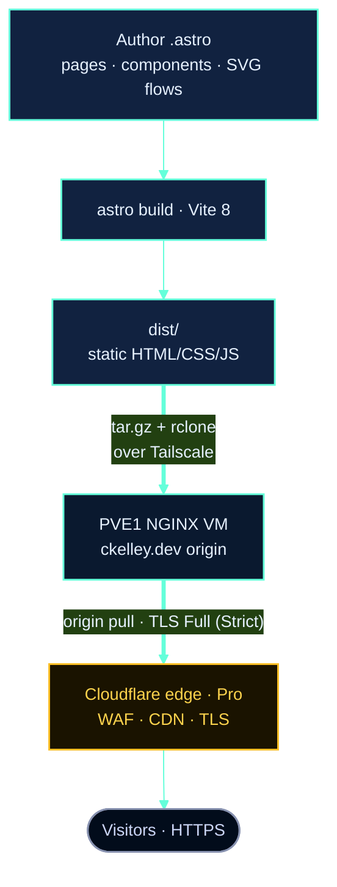

# Architecture & Decisions

This document captures the technical decisions behind the site and why they were made.

## Goals

The site is a personal portfolio that doubles as a living technical resume for Christopher
Kelley. The priorities, in order, are:

1. **Fast page loads** — the site is a first impression; it should render instantly.
2. **Low operating cost / low maintenance** — no application server, database, or CMS to
   patch. The output is static files behind NGINX.
3. **A credible infrastructure showcase** — the `/architecture` page renders real topology as
   hand-authored, animated diagrams rather than stock screenshots.
4. **Easy content updates** — pages are authored as `.astro` files with data arrays at the top.

## Key Decisions

### Static site generation with Astro

**Decision:** Use [Astro](https://astro.build) 7 with static output.

**Why:** Astro renders everything to plain HTML/CSS at build time and ships almost no
JavaScript. For a content-driven portfolio this is ideal — pages load instantly, there is no
hydration cost, and the output is trivially cacheable at the Cloudflare edge. Astro's component
model (`.astro` files) keeps markup, scoped styles, and light logic together without pulling in
a full client-side UI framework like React or Vue.

**Trade-off:** Anything genuinely dynamic must be handled by a sprinkle of client JS rather
than server code. For this site that is a feature — see Alpine.js below.

### Tailwind CSS v4 (CSS-first)

**Decision:** Use [Tailwind CSS v4](https://tailwindcss.com) through the `@tailwindcss/vite`
plugin, with a CSS-first `@theme` block and a set of `@utility` classes in `global.css`.

**Why:** Tailwind v4 defines the design tokens directly in CSS (`@theme { --color-navy: … }`)
rather than a JavaScript config. The navy/teal palette, fonts, and animation keyframes all live
in one `src/styles/global.css` file, and repeated patterns (`section`, `card`, `btn`,
`heading`, the `flow-*` SVG primitives) are promoted to `@utility` definitions so markup stays
short. The Vite plugin means there is no separate PostCSS/Tailwind build step to wire up.

**Trade-off:** v4's CSS-first model is newer; some class strings are written out in full in
component props so Tailwind's scanner can see them (see `DiagramNode.astro`).

### Alpine.js for interactivity

**Decision:** Use [Alpine.js](https://alpinejs.dev) 3.x, loaded from a CDN with `defer`, for
the handful of interactive pieces. No build-step framework.

**Why:** The site needs a small amount of client behavior — the mobile navigation toggle, the
scroll-spy `SectionNav`, the hero's rotating "typing" role animation, and the animated terminal
widget. Alpine provides declarative `x-data`/`x-show`/`x-text` directives inline in the markup
with a tiny footprint and no bundling.

**Trade-off:** Alpine loads from a CDN, adding one external request. For this level of
interactivity that is an acceptable cost and keeps the framework out of the build. (A small
amount of vanilla `<script>` also powers the `IntersectionObserver` reveal-on-scroll and the
hero particle canvas.)

### TypeScript with Astro's strict config

**Decision:** Extend `astro/tsconfigs/strict` and define path aliases.

**Why:** Strict typing catches mistakes in component props early (the diagram primitives are
heavily prop-driven). Path aliases (`@components/*`, `@layouts/*`, `@styles/*`) keep imports
readable instead of deep relative paths.

### Hand-authored inline-SVG diagrams (no charting library)

**Decision:** Build the infrastructure diagrams as hand-authored inline SVG in
`src/components/diagram/`, with no Mermaid, D3, or other charting dependency.

**Why:** The `/architecture` page is the centerpiece. Its ~22 flow diagrams are
coordinate-authored to match real topology, themed to the site's navy/teal system via
`--node` / `--edge` CSS custom properties, and animated with a CSS-only "flowing dash" along
each edge. Inline SVG renders with the page (no extra requests, no client charting runtime),
inherits theme colors, and is fully accessible (`role="img"` with `<title>`/`<desc>`,
decorative markers `aria-hidden`). Each diagram carries its own scoped `<defs>` with a
uniquely-suffixed arrowhead marker so multiple diagrams coexist on one page.

The system is built from three primitives — `DiagramFrame` (titled, tone-tinted card with a
horizontal-scroll wrapper and legend slot), `DiagramLane` (a labeled band of nodes with an
optional animated dataflow connector), and `DiagramNode` (a themed box with icon, title, and
sub-label) — plus the standalone `flows/*.astro` SVGs for true branching/merging graphs.

**Trade-off:** Diagrams are coordinate-authored, so editing topology means adjusting node
`x`/`y`/`w` values. The payoff is pixel-accurate, on-brand, dependency-free graphics that honor
`prefers-reduced-motion`.

### NGINX origin behind Cloudflare

**Decision:** Serve the built `dist/` directory as static files from an NGINX VM on the PVE1
bare-metal cloud node, fronted by Cloudflare on the Pro plan.

**Why:** Static files behind NGINX are about as fast, cheap, and secure as hosting gets — no
runtime to exploit or patch. Cloudflare terminates TLS at the edge, runs the WAF and bot
management, and caches globally; NGINX serves the origin and handles security headers and
long-lived caching for hashed assets. See [deployment.md](deployment.md) and
[cloudflare.md](cloudflare.md).

## Resulting Architecture

No database, no application server, no server-side runtime to maintain. The origin is locked
down behind Tailscale (key-based SSH only) and only accepts origin pulls from Cloudflare on
443; TLS is automated with acme.sh + Let's Encrypt via Cloudflare DNS-01. See
[deployment.md](deployment.md) for the full pipeline, [cloudflare.md](cloudflare.md) for the
edge, and [security.md](security.md) for the network posture and CrowdSec setup.

## The Diagram System

The `/architecture` page is organized into domain sections, each rendering one or more
hand-authored flow components. The diagrams reuse the `flow-*` primitives and per-domain accent
tones (teal, aqua, violet, red, amber, blue, emerald, slate) defined in `global.css`.

| Domain section | Flow components |
|----------------|-----------------|
| **Topology** | `DeploymentTopologyFlow` |
| **Edge & SD-WAN** | `FortiGateSdwanFlow`, `SdwanLoadBalanceFlow`, `ServerLoadBalanceFlow`, `SslInspectionFlow`, `Layer7FilterFlow`, `LookingGlassFlow` |
| **Virtualization** | `LiveMigrationFlow`, `IommuSplitFlow` |
| **CUDA** | `CudaDeliveryFlow`, `CudaClusterFlow`, `NvidiaContainerToolkitFlow`, `ContainerDriverSplitFlow` |
| **RAID & Redundancy** | `RaidRedundancyFlow` |
| **Backup & DR** | `BackupStrategyFlow`, `ArchBackupFlow`, `ProxmoxBackupFlow`, `VeeamBackupFlow`, `BackupEncryptionFlow` |
| **Security** | `SecurityOverlayFlow` (plus `DiagramFrame`/`Lane`/`Node` lane diagrams) |
| **Observability** | `LogPipelineFlow`, `MetricsPipelineFlow` |

See [content.md](content.md#diagram-components) for the full diagram inventory and
[design-system.md](design-system.md#svg-flow-primitives) for the underlying CSS primitives.
