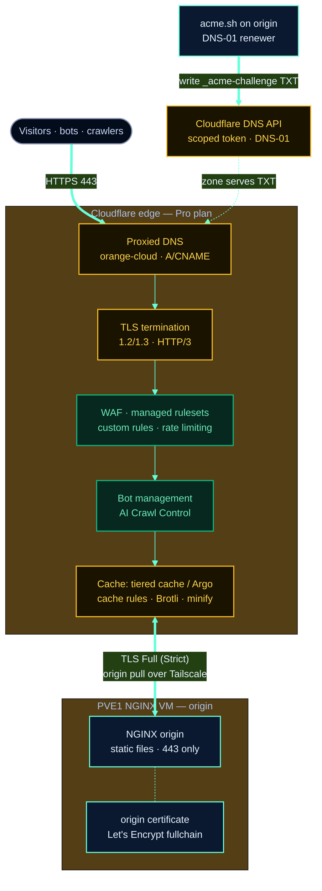

# Cloudflare Edge

The site sits behind [Cloudflare](https://cloudflare.com) on the **Pro plan**. Cloudflare is the
public front door: it terminates TLS, runs the WAF and bot management, caches and accelerates
content globally, and proxies traffic back to the NGINX origin — the NGINX VM on the **PVE1
bare-metal cloud node** (Proxmox SDN). The origin is only reached privately and never serves the
public directly.

## Overview

| | |
|---|---|
| **Plan** | Cloudflare Pro |
| **DNS records** | Proxied (orange-cloud) for `ckelley.dev` and `www` |
| **Edge TLS** | TLS 1.2/1.3 terminated at the edge; HTTP/3 enabled |
| **Origin TLS** | Full (Strict) using the Let's Encrypt origin certificate |
| **Origin reach** | NGINX origin reachable over Tailscale; only 443 from Cloudflare |
| **Security** | WAF managed rulesets, custom firewall rules, rate limiting |
| **Bots** | Bot management + AI Crawl Control |
| **Performance** | Tiered cache / Argo, cache rules, Auto Minify, Brotli, HTTP/3 |
| **Certificates** | DNS-01 via scoped Cloudflare API token (see deployment) |

## Edge Topology

## Proxied DNS

Both public hostnames — `ckelley.dev` and `www.ckelley.dev` — are **proxied** records (the orange
cloud). Visitor traffic resolves to Cloudflare's anycast network, not directly to the origin IP,
so the origin address is never exposed in DNS. The origin pull happens privately; the PVE1 NGINX
VM accepts origin traffic only on 443 and is otherwise locked behind Tailscale and a default-deny
firewall (see [security.md](security.md)).

## WAF & Firewall Rules

Cloudflare's **WAF** runs in front of every request:

- **Managed rulesets** — Cloudflare's curated OWASP-style rules block common injection,
  traversal, and exploit patterns before they reach the origin.
- **Custom firewall rules** — site-specific rules (for example, challenging suspicious
  geographies or ASNs, or restricting unexpected request patterns).
- **Rate limiting** — per-IP request thresholds throttle abusive clients and brute-force
  attempts, complementing the CrowdSec bouncer at the origin.

This layers cleanly on top of the origin-side CrowdSec enforcement: Cloudflare drops the bulk of
malicious traffic at the edge, and the CrowdSec nginx bouncer enforces the central decision list
for anything that reaches NGINX.

## Bot Management & AI Crawl Control

- **Bot management** scores and filters automated traffic, letting verified good bots through
  while challenging or blocking bad ones.
- **AI Crawl Control** governs how AI crawlers and scrapers may access the site, so content is
  not harvested indiscriminately.

## Caching & Performance (Pro plan)

The following are **Cloudflare Pro plan** features used to accelerate the static site:

- **Tiered cache / Argo** — Cloudflare's tiered topology (and Argo Smart Routing where enabled)
  keeps cached content closer to the origin tier and routes origin pulls over optimized paths,
  reducing origin load and latency.
- **Cache rules** — fine-grained rules control what is cached and for how long, complementing
  the origin's own `Cache-Control` headers (long-lived immutable for hashed `/_astro/` assets —
  see [deployment.md](deployment.md#what-the-config-does)).
- **Speed features** — **Auto Minify**, **Brotli** compression, and **HTTP/3** are enabled for
  smaller, faster transfers to visitors.

Because the origin emits long-lived, immutable cache headers on hashed assets, Cloudflare can
serve the vast majority of requests from cache without touching the origin.

## TLS Full (Strict)

Cloudflare terminates TLS at the edge (1.2/1.3, with HTTP/3), and the connection from Cloudflare
back to the origin uses **Full (Strict)** mode. This means Cloudflare validates the origin's
certificate rather than trusting any self-signed cert:

- The origin presents the **Let's Encrypt certificate** issued by acme.sh
  (`/etc/nginx/certs/ckelley.dev/fullchain.crt`), which is publicly trusted, so Full (Strict)
  validates cleanly.
- End-to-end the path is encrypted twice: visitor↔Cloudflare and Cloudflare↔origin.

## DNS-01 Certificate Issuance

Because DNS is hosted at Cloudflare, certificate issuance uses **DNS-01 validation via a scoped
Cloudflare API token** (`dns_cf`). acme.sh writes the `_acme-challenge` TXT record through the
Cloudflare API, Let's Encrypt validates it, and the certificate is installed on the origin with a
reload hook. The token is least-privilege (**Zone.DNS:Edit + Zone.Read**, scoped to the
`ckelley.dev` zone) and lives only in acme.sh's environment on the VM (`CF_Token`,
`CF_Account_ID`).

See [deployment.md](deployment.md#tls-certificates) for the full DNS-01 flow diagram and the
one-time Cloudflare DNS setup steps.
