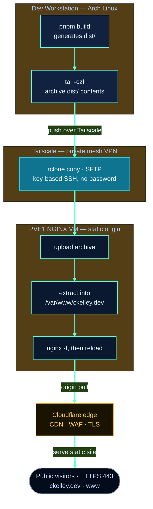
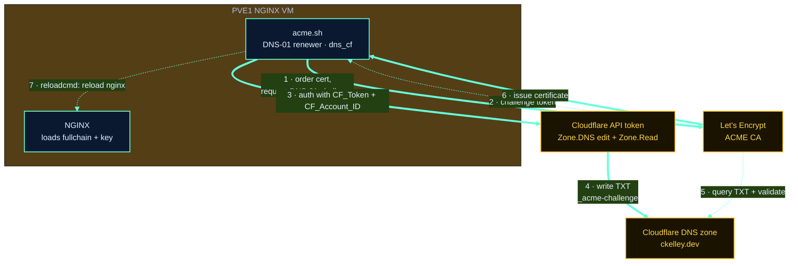

# Deployment

The site builds to static files and is served by NGINX over HTTPS on an NGINX VM on the **PVE1
bare-metal cloud node** (Proxmox SDN), fronted by Cloudflare. There is no application runtime to
deploy or keep running. All administrative access to the host happens over a private Tailscale
network — SSH is never exposed to the public internet.

## Overview

| | |
|---|---|
| **Build output** | `dist/` (static HTML/CSS/JS) |
| **Transfer** | `tar.gz` archive copied via `rclone` over SSH (SFTP) |
| **Transport** | Tailscale (private mesh VPN, key-based SSH, no password) |
| **Host** | NGINX VM on the PVE1 bare-metal cloud node (Proxmox SDN) |
| **Edge** | Cloudflare (Pro plan), proxied DNS, TLS Full (Strict) |
| **Web root** | `/var/www/ckelley.dev` |
| **Domains** | `ckelley.dev`, `www.ckelley.dev` |
| **TLS** | acme.sh + Let's Encrypt, DNS-01 validation via a scoped Cloudflare API token |

## Pipeline



Public visitors reach the site through Cloudflare over HTTPS (443); Cloudflare pulls from the
NGINX origin on the PVE1 VM. The deploy and management path is entirely private: the workstation
connects to the VM by its Tailscale address using key-based SSH, so port 22 is never published
to the internet. See [cloudflare.md](cloudflare.md) for the edge and [security.md](security.md)
for the full network posture and CrowdSec setup.

## Build

```bash
pnpm build
```

This produces a complete static site in `dist/`.

## Transfer & Deploy

Archive the build and push it to the VM with `rclone` over its SSH/SFTP backend (the remote
points at the VM's Tailscale hostname and uses key-based auth), then extract it into the web
root:

```bash
# 1. Build and archive
pnpm build
tar -czf ckelley.tar.gz -C dist .

# 2. Copy to the VM over Tailscale (rclone SFTP remote)
rclone copy ckelley.tar.gz pve1-web:/tmp/

# 3. On the VM: clean-replace into the web root, fix permissions
ssh pve1-web '
  sudo rm -rf /var/www/ckelley.dev/* &&
  sudo tar -xzf /tmp/ckelley.tar.gz -C /var/www/ckelley.dev/ &&
  sudo chown -R nginx:nginx /var/www/ckelley.dev &&
  rm /tmp/ckelley.tar.gz &&
  sudo nginx -t && sudo systemctl reload nginx
'
```

`pve1-web` is the Tailscale host (configured both as an `rclone` SFTP remote and an SSH host
alias). Because SSH is key-based and Tailscale-only, no passwords or public ingress are
involved. A clean wipe-and-replace is intentional so removed files do not linger. The local
archive is ignored by git — clean it up after deploying.

> **Note:** the root `README.md` shows a quick `rsync -avz --delete dist/ user@host:…` one-liner
> as a shorthand. Either approach works; the **tar + rclone-over-Tailscale** flow above is the
> documented production path, consistent with the other CK sites, because it rides the private
> tailnet and key-based SSH end to end. `rsync` over the same Tailscale SSH host is an acceptable
> alternative.

### Verify live

```bash
curl -sI https://ckelley.dev/ | head -1            # 200
curl -sI https://www.ckelley.dev/ | head -1        # 200
```

Then visually check `https://ckelley.dev/architecture` (the animated SVG diagrams).

## NGINX Configuration

Install the production server block once, then reload after any change:

```bash
sudo nginx -t && sudo systemctl reload nginx
```

### What the config does

- **HTTP → HTTPS redirect** for both hostnames.
- **Main site** (`ckelley.dev`, `www.ckelley.dev`):
  - TLS via the Let's Encrypt origin certificate (the same cert Cloudflare validates for Full
    (Strict) — see [cloudflare.md](cloudflare.md#tls-full-strict)).
  - Security headers: `X-Frame-Options`, `X-Content-Type-Options`, `X-XSS-Protection`,
    `Referrer-Policy`.
  - Gzip for text assets.
  - Long-lived immutable cache for hashed `/_astro/` assets; shorter cache for images and fonts.
  - `try_files $uri $uri/ $uri.html =404` so clean URLs resolve to the generated `.html` files.
- **Origin lock-down** — the VM only accepts 443 from Cloudflare; everything else is default-deny
  at the host firewall (see [security.md](security.md)).

## TLS Certificates

Certificates are issued and renewed automatically with [acme.sh](https://github.com/acmesh-official/acme.sh)
against Let's Encrypt, using **DNS-01** validation through the **Cloudflare API**:

- A single certificate covers `ckelley.dev` and `www.ckelley.dev`.
- DNS-01 (rather than HTTP-01) means the challenge is satisfied by creating TXT records in
  Cloudflare DNS — no inbound HTTP exposure is needed to validate, which suits the locked-down
  network posture and the proxied (orange-cloud) records.
- acme.sh authenticates to Cloudflare with a **scoped API token** (`dns_cf`). The token is
  least-privilege: **Zone.DNS:Edit + Zone.Read**, scoped to the `ckelley.dev` zone only. The
  credentials live in acme.sh's environment on the VM (`CF_Token`, `CF_Account_ID`) and are
  never committed to this repo.
- Renewals are automatic (acme.sh cron); the deploy hook reloads NGINX after a new cert is
  installed.

This is the same certificate NGINX presents to Cloudflare as the **origin certificate** for
TLS Full (Strict) — see [cloudflare.md](cloudflare.md#tls-full-strict).

### DNS-01 Flow



The challenge is proven entirely over outbound calls and DNS records — Let's Encrypt only ever
reads a public TXT record, so the VM needs no inbound HTTP for validation.

### Cloudflare DNS Setup (one-time)

To let acme.sh prove domain control via DNS-01, create a scoped Cloudflare API token, then point
acme.sh at it.

1. **Create a scoped API token** in the Cloudflare dashboard (My Profile → API Tokens → Create
   Token → Custom token). Grant least privilege, scoped to the `ckelley.dev` zone:
   - `Zone` → `DNS` → `Edit`
   - `Zone` → `Zone` → `Read`
   - Zone Resources: `Include` → `Specific zone` → `ckelley.dev`

2. **Export the credentials** in acme.sh's environment on the VM (keep them out of the repo):

   ```bash
   export CF_Token="<scoped-api-token>"
   export CF_Account_ID="<cloudflare-account-id>"
   ```

3. **Issue** the single certificate covering both names:

   ```bash
   acme.sh --issue --dns dns_cf \
     -d ckelley.dev \
     -d www.ckelley.dev
   ```

4. **Install** it where NGINX reads, with a reload hook so renewals take effect automatically:

   ```bash
   acme.sh --install-cert -d ckelley.dev \
     --key-file       /etc/nginx/certs/ckelley.dev/ckelley.dev.key \
     --fullchain-file /etc/nginx/certs/ckelley.dev/fullchain.crt \
     --reloadcmd      "sudo nginx -t && sudo systemctl reload nginx"
   ```

acme.sh installs a cron entry during setup, so subsequent renewals (and the NGINX reload) run
unattended.

The certificate paths NGINX reads from:

```
/etc/nginx/certs/ckelley.dev/fullchain.crt
/etc/nginx/certs/ckelley.dev/ckelley.dev.key
```

## Access & Network Posture

- **Tailscale** provides a private mesh network between the dev workstation and the PVE1 NGINX
  VM. All SSH and deploy traffic rides this overlay.
- **SSH** uses key-based authentication only (no password auth). Port 22 is not exposed to the
  public internet — the VM is reachable for administration only via its Tailscale address.
- **Public ingress** is limited to the web traffic NGINX serves over HTTPS, fronted by
  Cloudflare and accepted only from Cloudflare on 443. See [security.md](security.md) and
  [cloudflare.md](cloudflare.md).
